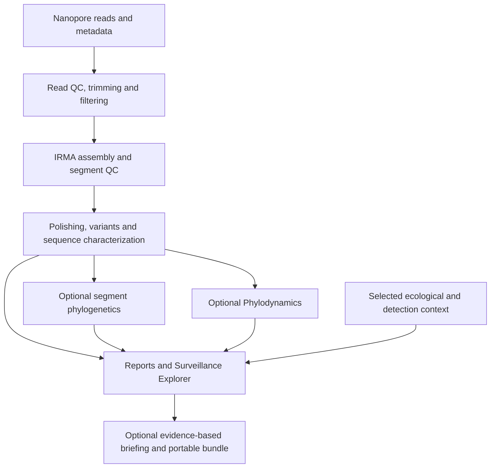

# Wild-bird Influenza Genomics and Surveillance (WINGS)

<p align="center">
  
</p>

WINGS analyzes avian influenza A virus from Oxford Nanopore sequencing reads and brings genomic results, sample metadata, geographic ancestry, and ecological context into an interactive **Surveillance Explorer**. It combines a Snakemake analysis workflow, a browser-based submission interface, and portable reports that can be viewed without rerunning the analysis.

WINGS was developed in support of the [Pandemic ESCAPE Center](http://www.escape-center.org/).

**Start here:** [Choose how to run WINGS](#choose-how-to-run-wings) · [Desktop setup](#desktop-setup) · [Submit a job](#submit-a-job) · [Phylodynamics](#phylodynamics-in-the-surveillance-explorer) · [Q&A](docs/faq.md) · [Detailed guides](#documentation)

## What WINGS provides

| Area | Outputs and capabilities |
| --- | --- |
| Read processing and assembly | Porechop ABI trimming, fastplong filtering, NanoPlot QC, IRMA FLU-minion assembly, and segment recovery checks. |
| Sequence evidence | Depth, breadth and N-content QC; Medaka polishing and variant calls; BLAST segment identification; H5Nx screening; GenoFLU assignment; VADR annotation. |
| Genomic exploration | Linked segment trees, genome coverage, amino acid variants, and genotype-frequency. |
| Phylodynamics | Optional Fast or BEAST-based dating/conditional geographic reconstruction, with a shared map, ancestry tree, Markov-jump chord diagram, viral introduction timeline, and phylodynamic location node probabilities. |
| Surveillance context | Metadata-matched eBird reporting and seasonal abundance, available BirdCast pilot data, weather, and USDA APHIS wild-bird detections with source provenance. |
| Reporting and reproducibility | Sample and run HTML reports, portable `.wings` bundles, saved data snapshots, configuration and source hashes, and diagnostic records. |
| Optional interpretation | An Ollama-generated **Knowledge for action** briefing based on the recorded evidence and tailored to the user's preference (wildlife, agriculture, or public health surveillance). |

## Choose how to run WINGS

| Route | Intended use | Requirements and status |
| --- | --- | --- |
| **[Desktop app — macOS only](https://github.com/ZooPhy/wings/releases/tag/desktop-preview-2026-11-18.1)** | Launch from an app, manage settings, and submit jobs in the browser. | Docker Desktop plus the WINGS app. Host Python, Conda and Snakemake are not required. |
| **Native local runner** | Run from a source checkout while using the same browser submission interface. | A compatible Python/Conda/Snakemake environment and the configured container runtime. |
| **Command line / HPC** | Scripted analyses, custom configuration, or scheduled cluster work. | Snakemake, Conda/Mamba, and the appropriate Docker, Apptainer, Singularity or local IRMA installation. See the [command-line guide](docs/command-line-guide.md). |
| **Report viewer / demo** | Explore completed results without installing the analysis pipeline. | Open the [WINGS portal](https://wings.scotchlab.org/) and load a `.wings` bundle or the demo. Bundle viewing is local to the browser. |

The project documents evaluated native Apple Silicon and Linux ARM64/SLURM configurations. These are distinct from the desktop preview, which runs a **Linux AMD64 runtime through Docker**, including on Apple Silicon. Windows/WSL2 workflow validation remains pending. The app's minimum declared macOS version is 13; Docker Desktop has its own [system requirements](https://docs.docker.com/desktop/setup/install/mac-install/).

## Desktop setup

Obtain the **[WINGS Desktop Preview](https://github.com/ZooPhy/wings/releases/tag/desktop-preview-2026-11-18.1)** pre-release. The app is distributed separately from a bare source checkout; a GitHub clone does not install the app.

1. Install and start [Docker Desktop](https://docs.docker.com/desktop/).
2. Extract the preview archive and move **WINGS.app** to Applications.
3. Open WINGS and choose where to create its **WINGS Workspace**.
4. Enter optional access details or choose **Add later**. Skipping is remembered for that workspace.
5. Choose **Open WINGS**. A setup progress page opens in your usual browser, followed by the submission interface when the service is ready.

The setup page shows six steps: **Check Docker Desktop → Install WINGS workflow → Prepare analysis runtime → Prepare influenza references → Prepare analysis tools → Start WINGS**.

The progress bar counts completed steps, not elapsed-time percentage. The current task, elapsed time and status updates remain visible during downloads and database building. A quiet process and a missing status update are reported differently. The technical log remains available for troubleshooting, but opening it is not required to follow normal setup.

Use **Settings → View setup progress** to reopen the page. Closing that browser tab does not cancel setup. After completion, the WINGS interface opens in another tab or window.

### Settings and optional access

| Setting | When it is needed | How it is used |
| --- | --- | --- |
| **Add or update NCBI email** | Reference retrieval for Phylodynamics. | Saved in the workspace and sent with NCBI requests. Choose **Add later** if this analysis is not needed yet. |
| **Add or update eBird access key** | Downloading uncached eBird Status & Trends products. | Requires a **Status & Trends access key**, not merely a general eBird API token. Hyphens and letter case are retained. Cached products can be reused without a new download. |
| **Configure Ollama** | Optional model-generated briefings. | Save a local server address and the exact installed model name. **Save and check** also tests availability. |
| **Check Ollama connection** | Before enabling a briefing, or when troubleshooting. | Checks the server and selected model from the WINGS container. It does not download a model or generate text. |
| **Share a folder with WINGS** | Reading inputs outside the usual Mac folder shortcuts. | Add or remove a folder using the native Mac chooser. Apply changes by restarting the service after active jobs finish. |
| **View setup progress / Open workspace / Export installation diagnostics** | Monitoring and troubleshooting. | Open the saved progress page, files, or a diagnostic report. |
| **Stop WINGS service** | A required service update or a deliberate shutdown. | Finish or stop jobs first. Closing a browser tab is not a service shutdown. |

Saving, skipping or cancelling a settings action returns to the launcher menu. **Quit** closes the launcher; **Open WINGS** hands setup/service work to the independent background coordinator. The launcher icon can then disappear while the service continues running.

Settings are workspace-specific. Refresh the WINGS browser page after changing access details or Ollama defaults. New launches/attempts read the applicable saved credentials; already-running processes retain their existing environment. Existing jobs retain their saved analysis configuration, including the Ollama model and endpoint.

### Input folders and output storage

The desktop context picker includes accessible **Home, Documents, Downloads, Desktop, WINGS Workspace and external drives**. Paste an absolute Mac path or `~/…` and choose **Go**, or add another location through **Settings → Share a folder with WINGS**.

Shared input folders are mounted read-only at their original paths. Selecting a path does not copy or import data; context preparation is a separate action. Docker Desktop and macOS must permit access. The workspace remains writable for run inputs, prepared context, caches and results. The output-storage picker remains restricted to the desktop workspace.

A workspace contains `runs/`, `cache/`, `releases/`, `logs/`, and app-managed settings. It is separate from a native checkout such as `~/wings`. Replacing the app does not replace or delete the workspace. See the [folder and storage Q&A](docs/faq.md#folders-and-storage).

### Updating the app

For **0.1.12**, finish active jobs, choose **Settings → Stop WINGS service**, choose **Quit**, replace the app and reopen it. This release changes the runner and needs one service restart. Its runtime recipe is unchanged from 0.1.11, so the existing Docker image, reference cache and credentials can be reused.

Later Ollama settings changes do not require another service restart; refresh the browser before creating a new job. Changes to shared folders require a restart because they change container mounts. Follow the instructions supplied with future releases rather than assuming every update has the same restart requirements.

## Native runner and command-line setup

Use this route when working directly from the repository or on a cluster. **Desktop users do not need to perform these steps inside the app's installed release folder.**

```bash
git clone https://github.com/ZooPhy/wings.git
cd wings
```

Then follow the [command-line guide](docs/command-line-guide.md) to install a compatible Conda/Snakemake environment, create `config.yaml`, install VADR models when applicable, and build the BLAST reference database. The guide retains the macOS, Linux ARM64/SLURM and proposed Windows/WSL2 instructions and resource examples.

For a configured native environment, start the browser runner with explicit installation paths:

```bash
bash scripts/start_wings.sh /path/to/conda /path/to/conda/envs/snakemake_env \
  --runs-dir /path/to/wings-runs \
  --conda-pkgs-dir /path/to/conda-cache
```

Replace the paths with your actual installation and writable storage. On Apple Silicon, check that the selected Python reports `arm64`; an Intel environment under Rosetta is a different execution route. See [native runner setup](docs/native-runner.md).

For native Phylodynamics reference retrieval, set `NCBI_EMAIL` in the environment that starts the runner. For uncached Status & Trends downloads, set `EBIRDST_ACCESS_KEY` there. Desktop Settings and native shell environment variables are separate configuration mechanisms.

## Submit a job

1. **Run details:** name the run, choose resources, and validate any edited storage locations.
2. **Reads:** select one FASTQ file per sample using a consistent supported filename extension.
3. **Metadata:** provide the sample table, select context sources, and use **Prepare context** for the selected sources. Review unavailable or mismatched data before continuing.
4. **Analysis:** select the optional modules, including Phylogenetics, Phylodynamics, Surveillance Explorer and/or the local briefing.
5. **Preflight:** resolve the displayed input, storage, runtime, reference-access and model checks, then start the job.

Context preparation derives geographic/date windows and host scope from metadata. It reuses compatible cached data and does not run assembly or polishing. Prepared context and its provenance are retained for that job. See [context setup](docs/context-setup.md) and [portable eBird context packages](docs/ebird-context-packages.md).

### Input data and metadata

A typical input file is `sample01.fastq.gz`; its sample ID is `sample01`. Match this ID exactly in the metadata table. Do not infer collection dates from filenames when explicit metadata are available.

| Field | Required? | Meaning |
| --- | --- | --- |
| `sample_id` | Yes | Matches the sample identifier derived from the FASTQ filename. |
| `host` | Yes | Recorded host species or code; `environmental` when applicable. |
| `collection_date` | Yes | ISO date, `YYYY-MM-DD`. |
| `country` | Yes | Country of collection. |
| `state` | No | State, province or equivalent administrative area. |
| `specimen_type` | No | Specimen or swab type. |
| `latitude`, `longitude` | No | Valid decimal coordinates when known; leave missing coordinates blank. |

Use [metadata.example.tsv](metadata.example.tsv) as a starting point. WINGS checks required fields, duplicate IDs, dates, coordinate ranges and agreement with the reads. Host codes remain recorded values; ecological matching may require a separate host-name mapping. Missing geographic precision is not replaced with invented coordinates.

### Choose analysis modules

| Option | Role |
| --- | --- |
| **GenoFLU** | Genotype assignment for samples eligible under the H5Nx screening logic. |
| **VADR annotation** | Sequence annotation and validation using the required influenza models. |
| **Phylogenetics** | Sample-only segment trees from QC-qualified consensuses. Each segment must meet its sequence-count threshold; the standard configuration requires at least five. |
| **Phylodynamics** | The H5 HA reference-based ancestry/geographic workflow. Choose **Fast** or **BEAST (MCMC)** after enabling it. |
| **Surveillance Explorer** | The integrated run-level results interface. Phylodynamics and the briefing include it as a dependency. |
| **Public health interpretation / agency briefing** | A narrative based on recorded evidence, using a separately installed Ollama model. |

**Phylogenetics is not a prerequisite checkbox for Phylodynamics.** The reference-based Phylodynamics workflow constructs its own required tree inputs. In the submission interface, Phylodynamics is opt-in and Fast is the default method once selected.

## Workflow



NanoPlot is enabled by default. Segment QC, failed tool outputs and missing evidence remain explicit. Selecting an optional module does not turn an unavailable result into a negative biological finding.

## Phylodynamics in the Surveillance Explorer

Open **Surveillance Explorer → Genomics → Phylodynamics**. The standalone report and embedded tab share the same viewer. Method buttons in a completed report select available results; they do not start a new analysis.

| Method | What it conditions on | Checks and limits |
| --- | --- | --- |
| **Fast** | A fixed dated maximum-likelihood tree, with conditional Bayesian geographic reconstruction. | Temporal-signal, source-integrity, numerical integration and Monte Carlo precision checks. Direct conditional geographic draws do not have MCMC ESS. |
| **BEAST (MCMC)** | BEAST posterior dates on the fixed rooted topology, followed by conditional geographic mapping. | Independent-chain convergence/ESS, date precision, mapping precision and provenance gates before results are released. Slower; failed diagnostics withhold results. |

The BEAST option propagates dating uncertainty; it is a modular dating-plus-geography analysis, not joint BEAST phylogeography. Neither current route samples topology uncertainty. Geography uses the recorded sampling locations and the implemented symmetric equal-rate CTMC. Directed jump counts are not estimates from an asymmetric `K(K−1)`-parameter rate matrix.

### Reading the viewer

- **Posterior summary** is the default. Ancestor colors show the most probable location at each node; click a node for its complete probability distribution. Fast dates are fixed; BEAST node dates are posterior medians.
- **Map and chord diagram:** summarize posterior mean Markov-jump counts through the selected date. Arrows indicate direction. The map initially shows the six strongest connected routes; **Show all** and the expanded map help explore dense connections without changing inference or counts.
- **Focus location:** study locations appear first. The initial focus is the location containing the most study samples, with alphabetical tie-breaking. It is not fixed to Kentucky or chosen from an ancestor's posterior state.
- **Geographic detail:** switch between regions and states/countries. Study locations stay separate in regional views; grouping changes presentation, not the fitted model. Within-group changes do not appear as between-group jumps.
- **Advanced → Explore uncertainty:** select **One posterior draw** to inspect a complete sampled reconstruction. It may contain zero or many jumps. The selected draw drives the map, tree and chord; the location-probability bars and other labeled posterior summaries still aggregate draws.
- **Advanced → Reference sampling:** compare separate reference sets against the predeclared primary result. The standard primary is location/time-balanced Set 1. Sets are sensitivity analyses, not performance ranks, and are not pooled into a single posterior.

Counts cover the WINGS study ancestry from its common ancestor to the study tips; ancestral stems and reference-only branches are excluded. A missing analysis or unrepresented location is not a zero-entry result. Passing diagnostics establishes numerical/convergence criteria, not the biological truth of the reconstruction.

The demo's Phylodynamics view is explicitly labeled a **simulated illustration**. It is not an inference from the demo sequencing samples.

See the [Phylodynamics Q&A](docs/faq.md#phylodynamics), [dating methods](docs/bayesian-dating.md), [posterior mapping](docs/posterior-phylogeography.md) and [report/reference guide](docs/report-reference.md#phylodynamics-report-maintenance).

## Reports and Surveillance Explorer

**Pipeline Results** contains run summaries, sample details, subtype/genotype distributions and genome coverage. **Surveillance Explorer** groups genomic views under **Genomics**, contextual views under **Ecological context**, and Concordance under **Integrated evidence**, with **Overview** as a direct destination.

Linked sample selection connects the map, collection timeline and available segment trees. Protein-variation views retain reference accessions and coordinate conventions. Public genotype charts distinguish WINGS sample counts from public SRA-run counts and keep their denominators separate.

APHIS detections, checklist reporting frequency, modeled seasonal abundance, migration estimates and weather are different measurements. Their units, geographic resolution, dates and provenance remain visible; missing observations are not converted to zero. APHIS overlap does not imply epidemiological linkage, and sampled genotype frequencies are not population prevalence.

| Output | Default location relative to the analysis directory |
| --- | --- |
| Sample HTML report | `results/<sample>/summary/<sample>.sample_summary.html` |
| Run HTML report | `results/run_summary/run_summary.html` |
| Portable report bundle | `results/wings_report_bundle.wings` |
| Validated metadata | `results/metadata/validated_metadata.tsv` |
| Run provenance | `results/run_summary/run_provenance.json` and `.tsv` |
| Fast Phylodynamics report, when produced | `results/run_summary/phylodynamics/results/fast_v1/index.html` |
| Optional briefing evidence and diagnostics | `results/run_summary/public_health_interpretation.json` |

The `.wings` bundle carries rendered reports, embedded data and provenance; it does not package the raw FASTQ files or the complete analysis workspace. Supported compressed bundles use `.wings.gz`. Reports can contain sample identifiers, locations and other sensitive metadata—review them before sharing.

Opening a saved HTML report or bundle does not refresh its embedded UI or data. Rebuild or use the relevant presentation-refresh tool when updating a saved report. Use the completed run's configuration and preserve an original copy. Detailed report controls, source semantics and rebuild commands are in the [report/reference guide](docs/report-reference.md).

## Optional local public-health briefing

The **Knowledge for action** panel appears on **Surveillance Explorer → Overview**. It summarizes the run's recorded findings, their interpretation and implications for surveillance; it does not change with individual sample selection.

For the desktop app:

1. Install and start Ollama separately, and install the model you intend to use.
2. Open **Settings → Configure Ollama**. The normal Mac address is `http://localhost:11434`; enter the exact installed model name.
3. Choose **Save and check**, or use **Settings → Check Ollama connection** after WINGS setup is ready.
4. Refresh the WINGS browser page, select the briefing option for the job, and run its model check.

WINGS maps the Mac address for access from Docker. A successful check means that the service responds and the model is listed; it does not test model quality, available memory or a complete generation. WINGS does not automatically download model weights.

The model receives structured result evidence and metadata, not raw reads, consensus sequences or tree files. Local inference requires a locally served model; selecting a cloud-backed model in a local Ollama service is a different data-handling choice. The generated narrative, evidence, prompts and diagnostics can be embedded in shared reports. Automated review does not replace scientific review.

See the [briefing Q&A](docs/faq.md#ollama-and-briefings) and [native configuration and report regeneration](docs/report-reference.md#optional-local-public-health-briefing).

## Reproducibility and validation

Runs record configuration, workflow and environment hashes, resource provenance, software/runtime details and diagnostic results. Keep the saved configuration and original data snapshots with the analysis. A bundled desktop source snapshot has its own manifest/hash; it should not be described as a clean Git checkout when Git metadata are unavailable.

Native workflow evaluation, numerical/model checks, browser tests and desktop installer acceptance are separate forms of evidence. The desktop preview's automated tests do not establish that every Mac, Docker configuration, dataset or model has been validated. Consult the preview's `VALIDATION.md`, the relevant method diagnostics and the [publication evaluation plan](docs/publication-evaluation.md).

## Documentation

| Guide | Contents |
| --- | --- |
| [Q&A](docs/faq.md) | Setup, settings, folders, inference interpretation, missing data and common recovery questions. |
| [Command-line guide](docs/command-line-guide.md) | Full native installation, VADR/BLAST setup, configuration examples, dry runs and Linux ARM64/SLURM execution. |
| [Report/reference guide](docs/report-reference.md) | Detailed report controls, ecological sources, provenance, output paths and saved-report rebuilding. |
| [Native runner](docs/native-runner.md) | Architecture checks and explicit run/cache locations. |
| [Context setup](docs/context-setup.md) | Preparing selected sources from sample metadata. |
| [eBird packages](docs/ebird-context-packages.md) | Reusing, importing and checking portable context packages. |
| [Phylodynamics](docs/phylodynamics.md) | Reference selection and temporal analysis. |
| [Bayesian dating](docs/bayesian-dating.md) / [posterior geography](docs/posterior-phylogeography.md) | BEAST dating and checked geographic propagation. |
| [Genotype frequencies](docs/genotype-frequencies.md) | Sources, denominators, data freshness and exports. |
| [Ecological context](docs/ecological-context.md) / [APHIS acquisition](docs/aphis-acquisition.md) | Measurement definitions, scope and provenance. |
| [Local model interpretation](docs/local-llm-interpretation.md) | Briefing inputs, staged generation and diagnostics. |

## Use of AI statement

Generative AI tools have assisted with code drafting, debugging, documentation, tests and workflow refinement. The authors and maintainers remain responsible for scientific and software-design decisions, review and validation.

The optional user-enabled briefing is a separate runtime use of a language model. Passing automated briefing checks does not mean a human has reviewed or endorsed its conclusions.
